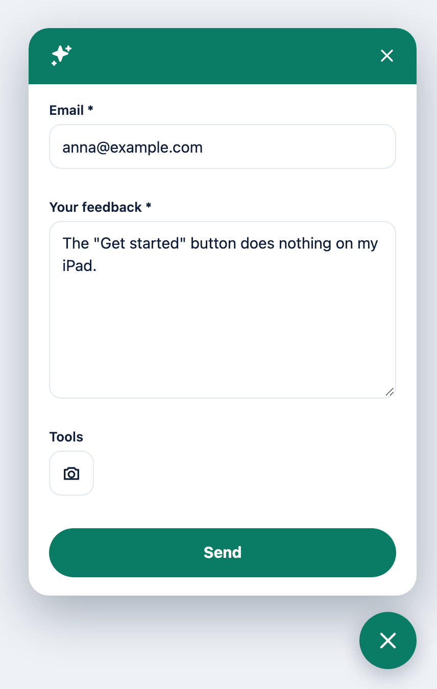
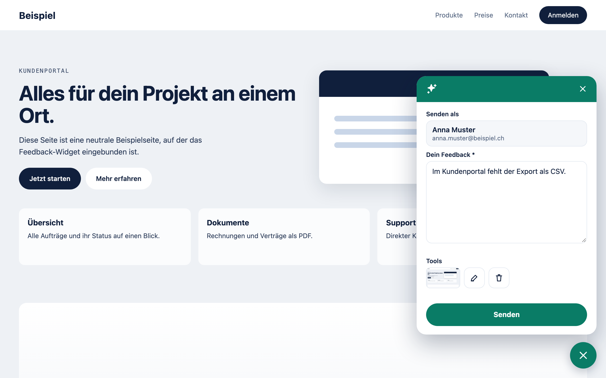
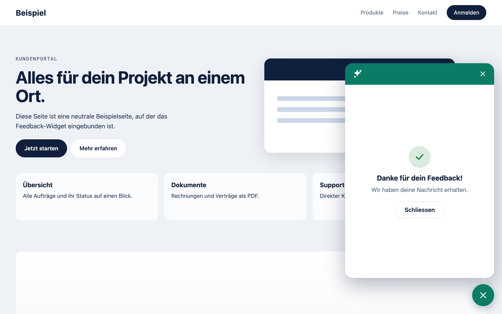
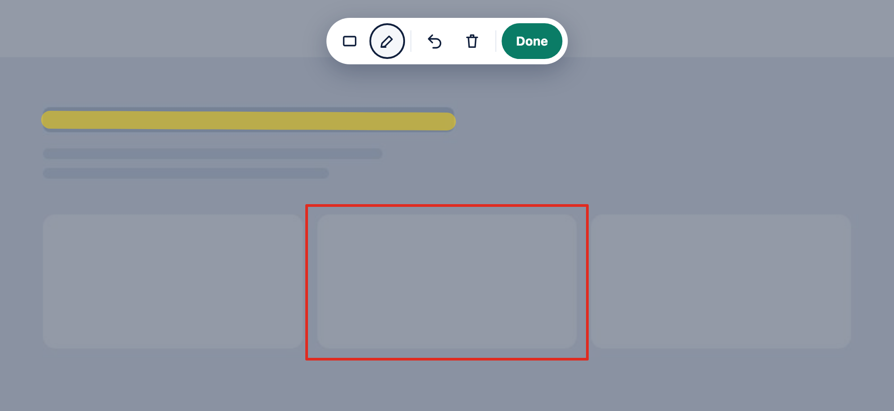

<h1 align="center">codebar Feedback</h1>

<p align="center">
  A self-hosted feedback widget for websites and web apps.<br>
  Visitors describe the problem, mark it on a full-page screenshot and send it. Browser data and console errors come along automatically.
</p>

<p align="center">
  <a href="https://github.com/codebar-ag/feedback.codebar.ch/actions/workflows/pest_database_matrix_pull_request.yml"></a>
  <a href="https://github.com/codebar-ag/feedback.codebar.ch/actions/workflows/e2e.yml"></a>
  
  
  <a href="LICENSE"></a>
</p>

<p align="center">
  
  &nbsp;
  
  &nbsp;
  
</p>

## Features

**For visitors**

- **Full-page screenshots** on demand, with a rectangle and a highlighter to mark the problem. Close with ✕ or Esc
- **Share link after sending**: the thank you screen shows a link to the submitted feedback with a copy button
- **Drafts survive** closing the panel, navigating and reloading the page
- **Four languages** (`de_CH`, `fr_CH`, `en_CH`, `it_CH`), every text can be overridden
- **Accessible** (WCAG 2.2 AA), keyboard and touch friendly, bottom sheet on phones

**For your team**

- **Diagnostics**: console errors, failed requests, browser, OS, viewport, page size and your own `customData`
- **Feedback page per entry**: a signed, expiring link shows every detail and the screenshot, with download and buttons to complete or reopen. No login, no admin panel to run
- **Artisan workflow**: list, filter by project, show, export, link, complete and reopen, all with `--json` for scripts
- **Hooks**: widget events in the browser, a Laravel event on the server for Slack, mail or your ticket system
- **Activity log**: who completed or reopened what, from the CLI or from a link

**For your stack**

- **Any website or app**: one script tag, served by your own API. React, Vue, Alpine, Livewire, plain HTML, no npm and no build step on the website. Isolated in a Shadow DOM, 18 KB gzip, no runtime dependencies. Updates arrive with every API deploy
- **Many projects, many environments**: one API serves any number of projects, each with several origins (wildcards and `localhost:*` included), optional IP ranges, its own color and daily limit
- **Privacy first**: mask elements with `data-feedback-mask`, password fields are always hidden, console logs are redacted in the browser
- **Your data, your server**: a small Laravel API with origin and IP allowlists, rate limits and a honeypot. Screenshots are stored in your database (SQLite, MySQL or PostgreSQL)

## How it works

1. Your website loads the widget from your API with one script tag. It runs in a Shadow DOM that leaves your styles untouched.
2. A visitor writes feedback and can attach a screenshot of the whole page. In marking mode they draw rectangles or highlight text:

<p align="center">
  
</p>

3. The widget sends message, screenshot and diagnostics to your API: `POST /v1/projects/{key}/feedback`.
4. The API checks origin, IP and rate limits, stores everything in your database and answers with a signed link to the feedback, which the thank you screen offers to copy.
5. Your team works through the feedback with Artisan commands or shares a [feedback page link](#feedback-pages-and-share-links) with whoever fixes it, who can mark it as completed right there.

The repository contains both parts: the **API**, a Laravel 13 app in the root folder, and the **widget** in [`widget/`](widget), which the deploy build compiles and the API serves at `/widget/v1/feedback.js`.

## Quick start

**1. Install the API**

```bash
git clone https://github.com/codebar-ag/feedback.codebar.ch.git feedback && cd feedback
composer install
cp .env.example .env && php artisan key:generate
touch database/database.sqlite && php artisan migrate
php artisan serve
```

**2. Create a project**

```bash
php artisan feedback:project:create "Example Website" --origin=https://www.example.com --color="#0A7C66"
```

```
   INFO  Project created.

  Name ............................................................. Example Website
  Public Key ....................................... fbk_live_92T7QQB6fj6Zb37jBGzrDI
  Active ....................................................................... yes
  Origins .................................................. https://www.example.com
  IPs ............................................................. (no restriction)
  Color ................................... #0A7C66 · text #FFFFFF · contrast 5.14:1
  Daily limit ........................................................... (no limit)
```

**3. Build the widget**

```bash
npm ci && npm run build   # Node 26, compiles the widget into resources/widget/v1
```

**4. Add it to your website**

```html
<script src="https://feedback.example.com/widget/v1/feedback.js"></script>
<script>
  CodebarFeedback.init({ projectKey: 'fbk_live_92T7QQB6fj6Zb37jBGzrDI', endpoint: 'https://feedback.example.com' });
</script>
```

That is all: no npm package, no bundler, no third-party CDN. The script always matches your API version.

## Widget

### Options

Only `projectKey` and `endpoint` are required.

```ts
const feedback = await CodebarFeedback.init({
  projectKey: 'fbk_live_92T7QQB6fj6Zb37jBGzrDI',
  endpoint: 'https://feedback.example.com',

  locale: 'en_CH', // de_CH | fr_CH | en_CH | it_CH, defaults to the page language

  // Signed-in user: replaces the email field with "Sending as". Not verified by the server.
  identity: { id: '4711', name: 'Anna Muster', email: 'anna@example.com' },

  colors: { primary: '#0A7C66' }, // overrides the project color: black, white or hex
  position: 'bottom-right', // or 'bottom-left'
  launcher: { style: 'icon' }, // 'text' shows `label` next to the icon
  zIndex: 2147483000,

  screenshot: { mode: 'optional', quality: 0.82 }, // mode: optional | required | off

  diagnostics: {
    console: true, // console errors, uncaught errors, failed resources, CSP violations
    network: true, // failed fetch/XHR: method, URL without query, status, duration
    levels: ['error', 'warn'], // also: info, log, debug
    redact: [/CUST-\d{6}/], // extra rules, tokens, passwords, emails and card numbers are always redacted
  },

  mask: { selectors: ['.iban'], ignore: ['.chat-bubble'] }, // in addition to the data attributes below
  customData: { appVersion: '2.3.1', tenant: 'acme' }, // flat object, max. 8 KB
  messages: { en_CH: { submit: 'Send feedback' } }, // override single texts
  draft: { persist: true, ttlHours: 24 }, // keep the draft in this tab
});
```

Call `CodebarFeedback.init()` as early as possible: console errors are captured from that moment on. Calling it twice returns the same instance.

### Methods and events

```ts
feedback.open();
feedback.close();
feedback.identify({ id: '4711', name: 'Anna Muster', email: 'anna@example.com' }); // or null
feedback.setLocale('fr_CH');
feedback.setData({ plan: 'pro' });
feedback.hideLauncher();
feedback.showLauncher();
feedback.destroy({ clearDraft: true });

feedback.on('before_send', (payload) => {
  payload.custom_data = { ...payload.custom_data, route: location.pathname };
  // return false to cancel
});
feedback.on('after_send', ({ id, url }) => console.log('Feedback stored', id, url)); // url: share link, if enabled
feedback.on('error', ({ code, status }) => console.warn(code, status));
```

Events: `ready`, `open`, `close`, `before_send`, `after_send`, `error`.

### Privacy in screenshots

```html
<div data-feedback-mask>Customer number 12345</div> <!-- rendered as a solid block -->
<aside data-feedback-ignore>…</aside>              <!-- left out entirely -->
```

Password fields and `autocomplete="cc-*"` fields are always masked. Images from other hosts without CORS headers and cross-origin iframes render empty. If rendering fails, the feedback is sent without a screenshot.

### Loading the script

The API serves the widget at `/widget/v1/feedback.js` (cached 5 minutes) and loads the screenshot code lazily from `/widget/v1/chunks/…` (cached for a year, the file name changes with every build). Both are sent with `Access-Control-Allow-Origin: *`, so they work on any website. A new widget version reaches every website with the next API deploy.

**Without blocking the page**, start it when the script has loaded:

```html
<script async src="https://feedback.example.com/widget/v1/feedback.js" onload="CodebarFeedback.init({ projectKey: 'fbk_live_…', endpoint: 'https://feedback.example.com' })"></script>
```

**From your own JavaScript** (Vite, webpack, a strict CSP without inline handlers), load it on demand, for example after the first interaction:

```js
function loadFeedback(endpoint) {
  return new Promise((resolve, reject) => {
    const script = document.createElement('script');
    script.src = `${endpoint}/widget/v1/feedback.js`;
    script.onload = () => resolve(window.CodebarFeedback);
    script.onerror = reject;
    document.head.append(script);
  });
}

const CodebarFeedback = await loadFeedback('https://feedback.example.com');
const feedback = await CodebarFeedback.init({ projectKey: 'fbk_live_…', endpoint: 'https://feedback.example.com' });
```

### Laravel example

```blade
<script src="{{ config('services.feedback.url') }}/widget/v1/feedback.js"></script>
<script>
  CodebarFeedback.init({
    projectKey: @js(config('services.feedback.key')),
    endpoint: @js(config('services.feedback.url')),
    locale: @js(str(app()->getLocale())->replace('-', '_')),
    identity: @js(auth()->user()?->only(['id', 'name', 'email'])),
  });
</script>
```

In single-page apps call `feedback.identify(user)` after sign-in.

### Content Security Policy

Allow the API in `script-src` and `connect-src`, and `blob: data:` in `img-src`. Styles need nothing, the widget uses `adoptedStyleSheets`.

### Recipes

**Several environments, one project.** Production, staging, preview deployments and local development can share a project:

```bash
php artisan feedback:project:create "Shop" \
  --origin=https://shop.example.com \
  --origin=https://*.preview.example.com \
  --origin=http://localhost:*
```

**Internal tool.** Combine origins with the office network and VPN, both must match:

```bash
php artisan feedback:project:create "Intranet" --origin=https://intranet.example.com --ip=10.0.0.0/8 --ip=2001:db8::/32
```

**Acceptance testing.** Make the screenshot mandatory and tag every report with the build under test:

```ts
CodebarFeedback.init({ projectKey, endpoint, screenshot: { mode: 'required' }, customData: { build: '2026.10.3' } });
```

**Multi-tenant SaaS.** Send the tenant and plan along, and the signed-in user instead of an email field:

```ts
feedback.identify({ id: user.id, name: user.name, email: user.email });
feedback.setData({ tenant: tenant.slug, plan: tenant.plan });
```

**Your own button.** Hide the launcher and open the panel from your help menu:

```ts
feedback.hideLauncher();
document.querySelector('#report-problem')!.addEventListener('click', () => feedback.open());
```

**Analytics or support chat.** React to sent feedback in the page:

```ts
feedback.on('after_send', ({ id }) => analytics.track('feedback_sent', { id }));
```

## Managing projects and feedback

```bash
php artisan feedback:project:create "Name" --origin=https://app.example.com [--ip=10.0.0.0/8] [--color=black] [--limit=500]
php artisan feedback:project:list
php artisan feedback:project:show {key}
php artisan feedback:project:update {key} --add-origin=https://staging.example.com --color=white --deactivate
php artisan feedback:project:rotate-key {key}
php artisan feedback:project:delete {key} [--force] [--by="Name"]

php artisan feedback:list --open --project={key}
php artisan feedback:show {id}
php artisan feedback:link {id} [--expires=10080] [--by="Name"] [--read-only]
php artisan feedback:export {id} --path=./export
php artisan feedback:complete {id} {id} [--by="Name"]
php artisan feedback:reopen {id} [--by="Name"]
```

`feedback:list` shows the newest 20 entries: filter with `--project` (public key or ID), `--open` or `--completed`, and change the number with `--limit`.

### Multiple origins and IPs

`--origin`, `--add-origin`, `--remove-origin`, `--ip`, `--add-ip` and `--remove-ip` take one value each. Repeat the option for several hosts; comma-separated lists are not split:

```bash
php artisan feedback:project:create "Name" --origin=https://app.example.com --origin=https://staging.example.com --origin=http://localhost:3000
php artisan feedback:project:update {key} --add-origin=https://web.example.test --add-origin=https://preview.example.com
php artisan feedback:project:update {key} --remove-origin=https://staging.example.com
```

All commands accept `--json`, handy for scripts and CI:

```bash
php artisan feedback:list --open --project=fbk_live_92T7QQB6fj6Zb37jBGzrDI --json | jq -r '.[].id'
```

Changing commands accept `--by="Name"`, which is recorded in the activity log.

- **Origins**: `https://app.example.com` exact, `https://*.example.com` all subdomains, `http://localhost:*` any port, `*` any origin (needs `--allow-any-origin`).
- **IPs**: single addresses or CIDR ranges, IPv4 and IPv6. No IPs means no restriction. A request must match the origins **and** the IPs.
- **Visibility**: the widget only appears on pages the API accepts. It asks for the project config first and removes itself on a `403`, so a page outside the origins or IPs never shows a button. If the API cannot be reached, the widget still appears, in black.
- **Color**: `black`, `white` or a hex value. Text becomes white or dark blue, whichever has more contrast, and button tones are adjusted until they reach 4.5:1.
- **Daily limit**: `--limit=500` caps the entries per project and day, `--deactivate` / `--activate` switch a project off and on without deleting anything, `rotate-key` replaces a leaked key.

## Feedback pages and share links

Every entry has a page built for fixing it. The **Feedback** tab shows the screenshot first, with the sender's message floating over it: name, email, comment, page and time, sticky while you scroll and hideable with one click. The **Technical** tab lists the environment (browser, system, viewport, screen, language, IP, user agent …), the console with errors and warnings highlighted and stack traces, failed requests and custom data. Every value and log entry has a copy button, **Copy report** puts everything into the clipboard as plain text for a ticket. Download and full size are one click away, team links add **Mark as completed** / **Reopen**. The page is reached through a **signed, expiring link**: no account, no admin panel, nothing to install for whoever receives it.

**Team links** come from the CLI and can complete and reopen the entry:

```bash
php artisan feedback:link 01JD8Z4W8K5Q3F7N2M6R9T1V0X --by="Anna Muster"
```

```
  Expires ............................................ 2026-10-29 14:30:52 UTC
  Screenshot ................................................................ yes
  Status changes ........................................................ allowed

https://feedback.example.com/v1/feedback/01JD8Z4W8K5Q3F7N2M6R9T1V0X?by=Anna%20Muster&expires=…&manage=1&signature=…
```

| Option | |
|---|---|
| `--expires=` | Minutes the link is valid, default 10080 (7 days), at most 43200 (30 days) |
| `--by=` | Name written to the activity log when the status is changed through this link |
| `--read-only` | Page and screenshot only, without the buttons |
| `--json` | `url`, `screenshot_url` (direct download), `manage`, `expires_at` |

Paste the link into a ticket, a chat or an email. The developer opens it, downloads the screenshot and clicks **Mark as completed** when the fix is live.

**Share links for the sender** are returned by the API after sending and shown on the thank you screen with a copy button, so the visitor can attach the report to an email or a support ticket. They are always read-only and valid for `FEEDBACK_SHARE_LINK_MINUTES` (default 7 days, `0` turns them off).

**Notifications.** Every stored feedback dispatches `App\Events\FeedbackReceived`. A listener can post a team link to Slack, Teams or your ticket system:

```php
use App\Events\FeedbackReceived;
use App\Support\FeedbackLink;
use Illuminate\Support\Facades\Event;
use Illuminate\Support\Facades\Http;

Event::listen(function (FeedbackReceived $event): void {
    $link = FeedbackLink::page($event->entry, now()->addDays(14), manage: true, by: 'Slack');

    Http::post(config('services.slack.feedback_webhook'), [
        'text' => "New feedback for {$event->entry->project->name}: {$event->entry->message}\n{$link}",
    ]);
});
```

**Security.** Links are signed with `APP_KEY`; changing any part (ID, expiry, `manage`, `by`) invalidates them. Invalid and expired links get the same empty `403` as every other unknown URL. Anyone holding a link can use it until it expires, so pick the expiry to match where you share it. Rotating `APP_KEY` revokes all links at once. Pages are `noindex`, `no-store`, `no-referrer`, run only one inline script for tabs and copy buttons (allowed by a per-request nonce) and load nothing from other hosts. The link host comes from `APP_URL` (CLI) or the request (widget), so set `APP_URL` to the public URL of the API.

## Configuration

Set in `.env`, see [`config/feedback.php`](config/feedback.php):

| Variable | Default | |
|---|---|---|
| `FEEDBACK_ENDPOINT` | `APP_URL` | Public URL of the API, used in the init snippet |
| `FEEDBACK_DEFAULT_COLOR` | `black` | Color for projects without one |
| `FEEDBACK_LIMIT_PER_IP_PER_MINUTE` | `10` | `0` disables the limit |
| `FEEDBACK_LIMIT_PER_PROJECT_PER_MINUTE` | `60` | `0` disables the limit |
| `FEEDBACK_MIN_ELAPSED_MS` | `2000` | Faster submissions are dropped silently |
| `FEEDBACK_SHARE_LINK_MINUTES` | `10080` | Validity of the share link shown after sending, max. 43200, `0` turns it off |
| `APP_URL` | | Public URL of the API, used for links created with `feedback:link` |
| `TRUSTED_PROXIES` | | Load balancer or CDN addresses |
| `CACHE_STORE` | `file` | Use `database` or `redis` with several instances |
| `OH_DEAR_HEALTH_CHECK_*` | on, needs the secret | [Oh Dear](https://ohdear.app) application health |
| `NIGHTWATCH_API_TOKEN`, `NIGHTWATCH_APPLICATION_ID`, `NIGHTWATCH_ENVIRONMENT_ID` | | Health check fails while Nightwatch has open issues. Token from `php artisan nightwatch:login` (valid one year); the check only runs when token and application ID are set |

`DB_READ_HOST` and `DB_WRITE_HOST` are supported for read replicas.

## Deployment

- PHP 8.5 with `pdo_pgsql`, `pdo_mysql` or `pdo_sqlite`, `fileinfo` and `intl`. No queue worker needed.
- Node 26 at build time: `npm ci && npm run build` compiles the widget into `resources/widget/v1` (Laravel Cloud runs this as its build command). Without it `/widget/v1/feedback.js` answers `403`.
- Screenshots are up to 6 MB: set `post_max_size` and `upload_max_filesize` to at least 8 MB. On MySQL raise `max_allowed_packet` to 16 MB.
- Behind a load balancer set `TRUSTED_PROXIES`, otherwise IP allowlists and rate limits see the proxy.
- Run `php artisan schedule:run` every minute for the health checks.
- `GET /up` is the health endpoint. Every other path, including `/`, returns an empty `403` and is excluded from search engines. Browsers can only open validly signed feedback pages.

## HTTP API

| Method | Path | |
|---|---|---|
| `POST` | `/v1/projects/{key}/feedback` | Submit feedback (`multipart/form-data`, `Idempotency-Key` header) |
| `GET` | `/v1/projects/{key}/config` | Project color for the widget |
| `GET` | `/v1/feedback/{id}?expires=…&signature=…` | Feedback page (signed link) |
| `GET` | `/v1/feedback/{id}/screenshot?…` | Screenshot, `download=1` as attachment (signed link) |
| `POST` | `/v1/feedback/{id}/status?manage=1&…` | `status=completed` or `status=open` (signed team link) |
| `GET` | `/widget/v1/feedback.js` | The widget for the script tag, plus its lazy `chunks/` |
| `GET` | `/up` | Health check |

Responses: `201` created, `200` duplicate `Idempotency-Key`, `403` origin or IP not allowed, `404` unknown project, `413` too large, `422` validation failed, `429` rate limited. A successful submission returns:

```json
{ "id": "01JD8Z4W8K5Q3F7N2M6R9T1V0X", "status": "received", "url": "https://feedback.example.com/v1/feedback/01JD8Z…?expires=…&signature=…", "url_expires_at": "2026-10-29T14:30:52+00:00" }
```

`url` and `url_expires_at` are missing when share links are turned off. Every stored feedback dispatches `App\Events\FeedbackReceived`, see [Notifications](#feedback-pages-and-share-links).

## Security and privacy

The project key is public by design. Feedback pages are only reachable through signed, expiring links, see [Security](#feedback-pages-and-share-links). The origin check is enforced by browsers, so use IP allowlists for internal apps and keep rate limits on for public sites. The API stores email, message, screenshot, browser data and the full IP address: mention the widget in your privacy policy. Please report vulnerabilities as described in [SECURITY.md](SECURITY.md).

## Development

Requires PHP 8.5, Composer and Node 26.

```bash
composer install && npm --prefix widget ci
composer check                    # Pint, PHPStan, Pest
npm run build                     # builds the widget and copies it to resources/widget/v1
npm --prefix widget run check     # lint, types, Vitest, build, size budget
npm --prefix widget run e2e       # Playwright: Chromium, Firefox, WebKit, mobile
npm --prefix widget run e2e:full  # API and widget together
composer test:browser             # Pest browser tests of the feedback page (npx playwright install chromium first)
npm --prefix widget run dev       # playground with a mock API on http://localhost:4173/fixtures/index.html
```

There is nothing to publish: the widget ships with every API deploy. See the [changelog](CHANGELOG.md) for changes.

## License

MIT. See [LICENSE](LICENSE). Made by [codebar Solutions AG](https://www.codebar.ch).
