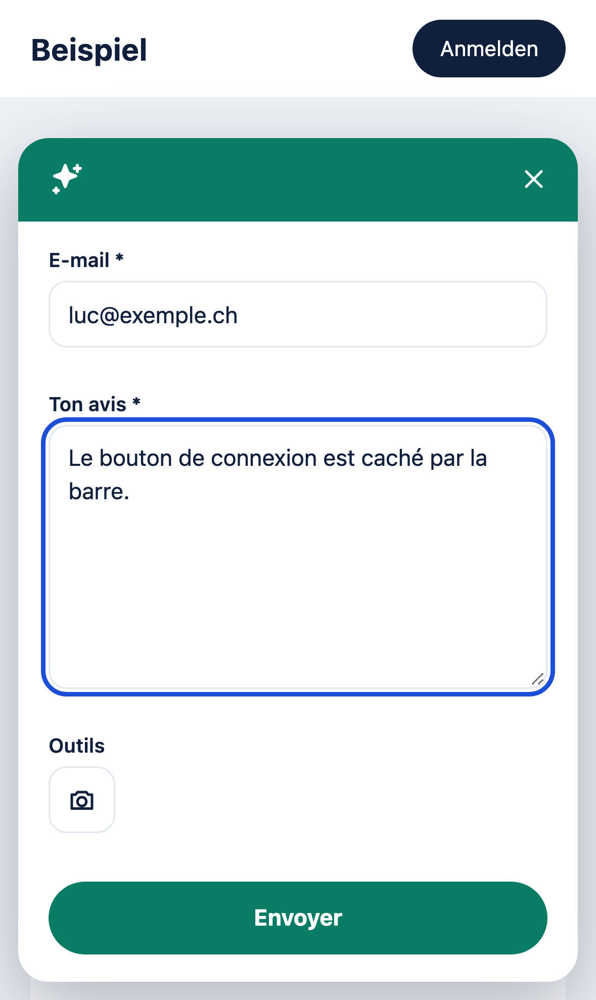

# codebar Feedback

[](https://github.com/codebar-ag/feedback/actions/workflows/tests.yml)
[](https://github.com/codebar-ag/feedback/actions/workflows/widget.yml)
[](https://github.com/codebar-ag/feedback/actions/workflows/e2e.yml)
[](https://github.com/codebar-ag/feedback/actions/workflows/security.yml)
[](https://www.php.net/)
[](https://laravel.com/)
[](https://nodejs.org/)
[](https://www.npmjs.com/package/@codebar-ag/feedback-widget)
[](LICENSE)

Ein schlankes, selbst gehostetes Feedback-Widget für Websites und Web-Apps. Besucher schreiben ihr Feedback, markieren auf einem Screenshot der ganzen Seite, was sie meinen, und senden es ab. Browserdaten und Konsolenfehler kommen automatisch mit. Die Feedbacks landen über eine eigene Laravel-API in deiner Datenbank, verwaltet wird per Artisan.

| Formular | Markieren | Mit Identität | Gesendet |
|---|---|---|---|
|  |  |  |  |



**Funktionen**

- Launcher, Formular und Bottom-Sheet auf Mobile, im Shadow DOM isoliert von deinem CSS
- Screenshot der ganzen Seite auf Klick, markieren mit Rechteck und Marker
- Verdecken sensibler Bereiche (`data-feedback-mask`, Passwortfelder immer)
- Entwurf bleibt bei Schliessen, Seitenwechsel und Reload erhalten (24 h)
- Konsolenfehler, fehlgeschlagene Requests und Browserdaten, im Browser redigiert
- `de_CH`, `fr_CH`, `en_CH`, `it_CH`, Projektfarbe mit automatischem Kontrast
- Domain- und IP-Freigabe pro Projekt, Rate Limits, Honeypot, Idempotenz
- WCAG 2.2 AA, Kern 18 KB gzip, keine Laufzeit-Abhängigkeiten

Das Repository enthält die **Laravel-API** im Wurzelverzeichnis und das **Widget** unter [`widget/`](widget), veröffentlicht als npm-Paket [`@codebar-ag/feedback-widget`](https://www.npmjs.com/package/@codebar-ag/feedback-widget).

<br clear="right">

[API installieren](#api-installieren) · [Konfiguration](#konfiguration) · [Projekte und Feedbacks](#projekte-und-feedbacks) · [Widget](#widget) · [API-Referenz](#api-referenz) · [Sicherheit und Datenschutz](#sicherheit-und-datenschutz) · [Entwicklung](#entwicklung) · [Release](#release)

## API installieren

Voraussetzungen: PHP 8.5 (`pdo_pgsql`, `pdo_mysql` oder `pdo_sqlite`, `fileinfo`, `intl`), Composer und eine Datenbank: PostgreSQL 17 (empfohlen), MySQL 8 / MariaDB oder SQLite. Kein Queue-Worker, kein Redis, kein Objektspeicher.

```bash
git clone https://github.com/codebar-ag/feedback.git && cd feedback
composer install --no-dev --optimize-autoloader
cp .env.example .env && php artisan key:generate
# in .env: DB_CONNECTION=pgsql, DB_HOST, DB_DATABASE, DB_USERNAME, DB_PASSWORD (bei Neon & Co. DB_SSLMODE=require) und FEEDBACK_ENDPOINT
php artisan migrate --force
php artisan config:cache && php artisan route:cache
```

Zum Ausprobieren genügt SQLite: `touch database/database.sqlite && php artisan migrate && php artisan serve`.

**Betrieb**

- Screenshots sind bis 6 MB gross: `post_max_size` und `upload_max_filesize` mindestens 8 MB, bei nginx `client_max_body_size 8m`.
- MySQL: die Migration legt `LONGBLOB` an, dafür `max_allowed_packet` mindestens 16 MB. PostgreSQL (`bytea`) und SQLite brauchen nichts.
- Hinter Load Balancer oder CDN `TRUSTED_PROXIES` setzen, sonst sehen IP-Freigabe und Rate Limits die Adresse des Proxys.
- Keine eigenen CORS-Header im Webserver für `/v1/`, die API setzt sie pro Projekt.
- Health-Check: `GET /up` (200 `{"status":"ok"}`, 503 bei Datenbankproblem).
- Die Screenshots liegen in der Datenbank: tägliche Sicherung mit Wiederherstellungstest. Löschfristen regelst du direkt in der Datenbank.

## Konfiguration

Alles in [`config/feedback.php`](config/feedback.php), gesetzt über `.env`:

| Variable | Standard | Bedeutung |
|---|---|---|
| `FEEDBACK_ENDPOINT` | `APP_URL` | Öffentliche URL der API für das Init-Snippet, z. B. `https://feedback.codebar.ch` |
| `FEEDBACK_DEFAULT_COLOR` | `black` | Farbe für Projekte ohne eigene Farbe (`black`, `white` oder Hex) |
| `FEEDBACK_LIMIT_PER_IP_PER_MINUTE` | `10` | Anfragen pro Minute je IP und Projekt, `0` = aus |
| `FEEDBACK_LIMIT_PER_PROJECT_PER_MINUTE` | `60` | Anfragen pro Minute je Projekt, `0` = aus |
| `FEEDBACK_MIN_ELAPSED_MS` | `2000` | Mindestzeit zwischen Öffnen und Senden, schnellere Anfragen werden still verworfen, `0` = aus |
| `TRUSTED_PROXIES` | leer | Kommagetrennte Proxy-IPs/CIDR oder `*` |
| `CACHE_STORE` | `file` | Store der Rate Limits: `file` für einen Server, `database` oder `redis` bei mehreren Instanzen |

Dazu kommt ein optionales Tageslimit pro Projekt (`--limit`). Gespeichert wird die volle IP-Adresse (IPv4 oder IPv6). Einen Standort ermittelt die App bewusst nicht, das kann eine andere Anwendung aus der IP übernehmen.

## Projekte und Feedbacks

Es gibt keine Verwaltungsoberfläche, alles läuft über Artisan:

```bash
php artisan feedback:project:create "Beispiel Website" --origin=https://www.beispiel.ch --origin="https://*.beispiel.ch" --color="#0A7C66"
```

```
   INFO  Projekt angelegt.

  Name .......................................................................... Beispiel Website
  Public Key ..................................................... fbk_live_MHoE8S6QzLaeMWMYt4GWP4
  Aktiv ....................................................................................... ja
  Origins ......................................... https://www.beispiel.ch, https://*.beispiel.ch
  IPs ...................................................................... (keine Einschränkung)
  Farbe .............................................. #0A7C66 · Schrift #FFFFFF · Kontrast 5.14:1
  Tageslimit ........................................................................ (kein Limit)
Init-Snippet:
  initFeedback({ projectKey: 'fbk_live_MHoE8S6QzLaeMWMYt4GWP4', endpoint: 'https://feedback.codebar.ch', locale: 'de_CH' })
```

| Command | Zweck |
|---|---|
| `feedback:project:create {name} --origin=* [--ip=*] [--color=] [--limit=] [--allow-any-origin]` | Projekt anlegen, gibt Schlüssel und Snippet aus |
| `feedback:project:list` | Alle Projekte mit Farbe, Freigaben, offen/erledigt |
| `feedback:project:show {key}` | Details eines Projekts |
| `feedback:project:update {key} [--name=] [--add-origin=*] [--remove-origin=*] [--add-ip=*] [--remove-ip=*] [--color=] [--limit=\|none] [--activate\|--deactivate]` | Projekt ändern |
| `feedback:project:rotate-key {key}` | Öffentlichen Schlüssel erneuern |
| `feedback:list [--project=] [--open] [--completed] [--limit=20]` | Neueste Feedbacks |
| `feedback:show {id}` | Feedback mit Browserdaten, Konsole und Screenshot-Infos |
| `feedback:export {id} [--path=]` | Schreibt `feedback-{id}.json` und den Screenshot |
| `feedback:complete {id…}` · `feedback:reopen {id…}` | Erledigt setzen oder wieder öffnen |

Alle Commands nehmen den Schlüssel oder die ID. `--json` liefert maschinenlesbare Ausgabe, `--by="Name"` hält im Activity-Log fest, wer etwas geändert hat. Exit-Codes: `0` ok, `1` nicht gefunden, `2` ungültige Eingabe.

- **Origins:** `https://app.beispiel.ch` (genau diese), `https://*.beispiel.ch` (alle Subdomains, nicht die Domain selbst), `http://localhost:*` (jeder Port), `*` (jede, nur mit `--allow-any-origin`).
- **IPs:** Adressen und CIDR, IPv4 und IPv6. Leer heisst keine Einschränkung. Origin **und** IP müssen passen.
- **Farbe:** `black`, `white` oder Hex. Schrift und Icons werden automatisch Weiss oder Dunkelblau, je nach Kontrast. Mittlere Töne werden für Buttons angepasst, bis 4.5:1 erreicht sind. Weiss bekommt eine Trennlinie und einen dunklen Senden-Button.
- **Activity-Log:** Änderungen an Projekten (inklusive Schlüsselrotation) sowie Erledigen und Wiedereröffnen landen in `activity_log` (`spatie/laravel-activitylog`), ohne Personendaten.

## Widget

```bash
npm install @codebar-ag/feedback-widget
```

```ts
import { initFeedback } from '@codebar-ag/feedback-widget';

const feedback = await initFeedback({
  projectKey: 'fbk_live_MHoE8S6QzLaeMWMYt4GWP4',
  endpoint: 'https://feedback.codebar.ch',
  locale: 'de_CH',
});
```

Rufe `initFeedback()` möglichst früh auf, Konsolenfehler werden erst ab dann erfasst. Ein zweiter Aufruf gibt dieselbe Instanz zurück.

### Alle Optionen

```ts
const feedback = await initFeedback({
  // Pflicht
  projectKey: 'fbk_live_MHoE8S6QzLaeMWMYt4GWP4', // öffentlich, geschützt wird über Origin- und IP-Freigabe
  endpoint: 'https://feedback.codebar.ch',

  // de_CH | fr_CH | en_CH | it_CH (Standard: lang der Seite, Fallback en_CH)
  locale: 'de_CH',

  // Eingeloggte Person: ersetzt das E-Mail-Feld durch «Senden als». Wird nicht vom Server verifiziert.
  identity: { id: '4711', name: 'Anna Muster', email: 'anna.muster@beispiel.ch' },

  // Überschreibt die Projektfarbe: black | white | Hex
  colors: { primary: '#0A7C66' },

  // Darstellung
  position: 'bottom-right', // oder 'bottom-left'
  launcher: { style: 'icon', label: null }, // style 'text' zeigt das Label neben dem Icon
  zIndex: 2147483000,

  // Screenshot: mode 'optional' | 'required' | 'off'
  screenshot: { mode: 'optional', quality: 0.82, maxPixels: 25_000_000 },

  // Diagnose
  diagnostics: {
    console: true, // Konsole, Fehler, Rejections, Ressourcen, CSP-Verletzungen
    network: true, // fehlgeschlagene fetch/XHR: Methode, URL ohne Query, Status, Dauer
    levels: ['error', 'warn'], // zusätzlich möglich: 'info', 'log', 'debug'
    maxEntries: 50,
    redact: [/KD-\d{6}/], // eigene Regeln zusätzlich zu Tokens, Passwörtern, E-Mails, Kartennummern
  },

  // Datenschutz im Screenshot, zusätzlich zu [data-feedback-mask] und [data-feedback-ignore]
  mask: { selectors: ['.iban'], ignore: ['.chat-bubble'] },

  // Eigene Daten, flaches Objekt, max. 8 KB
  customData: { app_version: '2.3.1', tenant: 'acme' },

  // Einzelne Texte überschreiben
  messages: { de_CH: { submit: 'Abschicken' } },

  // Entwurf im Browser (sessionStorage und IndexedDB, nur dieser Tab)
  draft: { persist: true, ttlHours: 24 },

  // CSP-Nonce, nur für Browser ohne adoptedStyleSheets
  nonce: undefined,
});
```

### Methoden und Events

```ts
feedback.open();
feedback.close();
feedback.showLauncher();
feedback.hideLauncher();
feedback.identify({ id: '4711', name: 'Anna Muster', email: 'anna.muster@beispiel.ch' }); // null entfernt sie
feedback.setLocale('fr_CH');
feedback.setData({ plan: 'pro' });
feedback.isOpen();
feedback.destroy({ clearDraft: true });

const off = feedback.on('after_send', ({ id }) => console.log('gespeichert', id));
feedback.on('before_send', (payload) => {
  payload.custom_data = { ...payload.custom_data, route: location.pathname };
  // return false bricht das Senden ab
});
feedback.on('error', ({ code, status, retryAfter }) => console.warn(code, status, retryAfter));
off();
```

Events: `ready`, `open`, `close`, `before_send`, `after_send`, `error`. Fehlercodes im `error`-Event: `origin_not_allowed`, `project_not_found`, `rate_limited`, `validation_failed`, `payload_too_large`, `server_error`, `network_error`, `timeout`.

### Script-Tag

Ohne Build-Pipeline. Der Screenshot-Chunk wird relativ zur Datei nachgeladen. Den SRI-Hash findest du im [GitHub-Release](https://github.com/codebar-ag/feedback/releases) oder in `dist/sri.json`.

```html
<script async src="https://unpkg.com/@codebar-ag/feedback-widget@1/dist/feedback.iife.js"
        integrity="sha384-…" crossorigin="anonymous"></script>
<script>
  window.addEventListener('load', function () {
    CodebarFeedback.init({ projectKey: 'fbk_live_MHoE8S6QzLaeMWMYt4GWP4', endpoint: 'https://feedback.codebar.ch', locale: 'de_CH' });
  });
</script>
```

Die API kann die Datei auch selbst ausliefern: `npm --prefix widget ci && npm --prefix widget run build && npm --prefix widget run publish:api` kopiert sie nach `public/widget/v1/`.

### Identität in Laravel

```blade
<script type="module">
  import { initFeedback } from '@codebar-ag/feedback-widget';

  initFeedback({
    projectKey: @js(config('services.feedback.key')),
    endpoint: @js(config('services.feedback.url')),
    locale: @js(str(app()->getLocale())->replace('-', '_')),
    identity: @js(auth()->check() ? ['id' => (string) auth()->id(), 'name' => auth()->user()->name, 'email' => auth()->user()->email] : null),
  });
</script>
```

In SPAs (Inertia, React, Vue) rufst du nach Login oder Benutzerwechsel `feedback.identify(user)` auf.

### Datenschutz im Screenshot und CSP

```html
<div data-feedback-mask>Kundennummer 12345</div> <!-- wird als deckender Block gerendert -->
<aside data-feedback-ignore>…</aside>              <!-- fehlt im Screenshot -->
```

Passwortfelder und `autocomplete="cc-*"` sind immer verdeckt. Bilder anderer Hosts ohne CORS-Header und fremde iframes erscheinen leer. Schlägt das Rendern fehl, geht das Feedback ohne Bild raus.

CSP: `connect-src` auf die API, `img-src blob: data:`, beim Script-Tag `script-src` für den Host der Datei. Styles brauchen nichts (`adoptedStyleSheets`).

## API-Referenz

| Endpoint | Zweck |
|---|---|
| `POST /v1/projects/{publicKey}/feedback` | Feedback senden, `multipart/form-data`, Header `Idempotency-Key: <uuid>` |
| `OPTIONS /v1/projects/{publicKey}/feedback` | CORS-Preflight |
| `GET /v1/projects/{publicKey}/config` | Projektfarbe für das Widget: `{"theme":{"primary":"#0A7C66"}}` |
| `GET /up` | Health-Check |

Pflichtfelder: `message` (3–5000 Zeichen), `email`, `locale`, `page_url`, `client` (JSON), `widget_version`, `elapsed_ms`. Optional: `identity`, `name` (nur mit `identity`), `page_title`, `referrer`, `console_log`, `network_log`, `annotations`, `custom_data`, `screenshot` (JPEG, PNG oder WebP bis 6 MB), `screenshot_error`, `submitted_from_url`, `website` (Honeypot, muss leer bleiben).

| Status | Bedeutung |
|---|---|
| `201` / `200` | gespeichert / bereits bekannt (gleicher `Idempotency-Key`), Body `{"id":"…","status":"received"}` |
| `403` | `origin_not_allowed`: Origin oder IP nicht erlaubt |
| `404` | `project_not_found`: unbekannt oder inaktiv |
| `413` | `payload_too_large` |
| `422` | `validation_failed` mit `fields` |
| `429` | `rate_limited` mit `Retry-After` |

Jedes neue Feedback löst `App\Events\FeedbackReceived` aus, der Einstiegspunkt für Benachrichtigungen (Mail, Slack, Ticketsystem).

## Sicherheit und Datenschutz

- Der Projektschlüssel ist öffentlich. Die Origin-Prüfung setzt der Browser durch, ein Skript ausserhalb des Browsers kann `Origin` fälschen. Interne Anwendungen schützt die IP-Freigabe, öffentliche Seiten Rate Limits, Mindestzeit, Honeypot und Grössenlimits.
- Konsolenlogs werden im Browser redigiert (Tokens, JWTs, `password=`/`token=`/`secret=`, E-Mails, Kartennummern), URLs gehen ohne Query raus. Antworten enthalten nie interne Details.
- Gespeichert werden E-Mail, Feedback, Screenshot, Browserdaten und die volle IP. **Erwähne das Widget in der Datenschutzerklärung der Website** (nDSG/DSGVO).
- Schwachstellen bitte vertraulich melden, siehe [SECURITY.md](SECURITY.md).

## Entwicklung

Voraussetzungen zusätzlich: Node 26.

```bash
composer install && npm --prefix widget ci
npm --prefix widget exec -- playwright install --with-deps chromium firefox webkit

composer check                    # Pint, PHPStan (Level 9), Pest
npm --prefix widget run check     # ESLint, Prettier, Typen, Vitest, Build, Grössenbudget, publint, attw
npm --prefix widget run e2e       # Playwright: Chromium, Firefox, WebKit, Mobile
npm --prefix widget run e2e:full  # Vollstack: Laravel + gebautes Widget
npm --prefix widget run dev       # Testseiten mit Mock-API: http://localhost:4173/fixtures/demo.html
```

Die Backend-Tests laufen standardmässig mit SQLite, in CI zusätzlich gegen MySQL und PostgreSQL. Ein anderes Ziel setzt du über `DB_CONNECTION`, `DB_HOST` usw. `npm --prefix widget run screenshots` erzeugt die Bilder in diesem README neu.

## Release

Das Widget wird bei einem Tag `v*` aus GitHub Actions per [Trusted Publishing](https://docs.npmjs.com/trusted-publishers) veröffentlicht, ohne Token und mit Provenance. Einmalig: `@codebar-ag/feedback-widget` einmal von Hand veröffentlichen (`npm --prefix widget publish --access public`), danach in den npm-Paketeinstellungen GitHub Actions mit `codebar-ag/feedback` und `release.yml` als Trusted Publisher eintragen. Trusted Publishing und Provenance setzen ein öffentliches Repository voraus.

```bash
npm --prefix widget version 1.1.0 --no-git-tag-version
git commit -am "chore: release v1.1.0" && git tag v1.1.0
git push --follow-tags
```

Der Workflow prüft, ob Tag und Version übereinstimmen, führt alle Checks aus, veröffentlicht auf npm und erstellt das GitHub-Release mit Changelog und SRI-Hash. Änderungen stehen im [CHANGELOG](CHANGELOG.md).

## Lizenz

MIT, siehe [LICENSE](LICENSE). Entwickelt von [codebar Solutions AG](https://www.codebar.ch).
